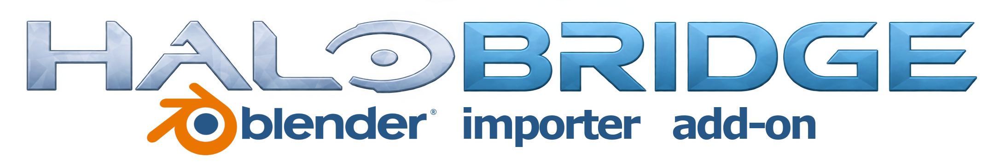

# HaloBridge — Blender Halo Level / Asset Importer + Sapien Level Preparation (Beta)

Made for Halo 3 Map Creators who wanna get going quickly and start placing/editing halo assets.

HaloBridge is a Blender add-on that brings Halo levels and assets from **Halo: CE, Halo 2, Halo 3, Halo 3: ODST and Halo: Reach** into Blender, fully textured, and then turns your Blender scene into a **Halo 3 (or ODST) Sapien test level** with one button. You can import a whole level from its Editing Kit `.scenario`, import an entire MCC `.map`, or browse a searchable list of every model, piece of scenery and material in a map and place exactly the ones you want. Assets from different games can be mixed in the same level, and a sky from any of these games can become your level's sky.

The Main reason for this mod tool was to make map making faster, eliminate *time-wasting procedures like having to constantly search and type out every file path* This Tool places everything in *clickable-dropdown-menus. *With HaloBridge After you click [Detect Folders], you don't need to go in and type out every single asset/material file path.
(Coded with Claude Ai, guided by user input)
**Viewport scale:** Halo:MCC Assets uses a 100× scale compared to blenders scale.

## What you can do

- **Detect folders** finds Editing Kits and MCC in every Steam library and Xbox app / PC Game Pass installs, and storage follows a Documents folder moved by OneDrive.
**Import level from .scenario (Halo 3).** HaloBridge now reads a level from your extracted H3EK tags instead of reconstructing it from compiled `.map` data. BSP geometry comes from the source files stored in the BSP tags, with original instance names and transforms; every scenery, crate, machine, control and vehicle placement comes from the scenario with its variant; each surface gets its real shader tag and source flags. The matching `.map` only supplies preview textures, looked up by exact shader path.
- **Original scenery stays scenery.** When you prepare a scenario import for Sapien, unedited scenery is written as placements of its own scenery tag, keeping its collision and physics. Vehicles keep their vehicle tags. Edited objects export as static geometry.
- **Halo 3: ODST** is a full game: index and import its `.map` files, import levels from the H3ODSTEK `.scenario`, and prepare ODST Sapien levels.
- **Halo: CE and Halo 2** import from MCC `.map` files, and from their Editing Kit `.scenario` tags (HCEEK / H2EK; the kit's own Tool builds the map first).
- **Halo: Reach `.scenario` import** places objects from the HREK scenario (geometry comes from the matching `.map`).
- **Every game asset in one level.** Assets from any import game can be prepared together in a Halo 3 Sapien level; their shaders are converted automatically.
- **Skies from any game.** **Sapien Sky** has a **Game** choice: use a Halo 3 kit sky, or convert a Halo: CE, Halo 2, ODST or Reach sky into your level.
- **Index .scenario Assets** and a source filter (All / .map / .scenario) in the asset list.
- **Blender 5.2 support.** Runs on Blender 4.0 through 5.2. On 4.1 and newer, use the current Halo Asset Blender Development Toolset release.
- **Import an entire `.map`** from your MCC installation: terrain, instanced geometry, objects and skies at their original positions, with preview textures.
- **Browse a level's assets** in a searchable, filterable list. Turn on **Preview Mode**, click a row, and the asset appears at your 3D cursor. Click **Place asset(s)** to keep it.
- **Mix games.** Put a Halo 2 rock, a Reach tree and a Halo 3 bridge in the same level. Materials from other games are converted to Halo 3 bitmaps and shaders automatically when you prepare.
- **(Experimental)Use a sky from any game.** Pick a game, then a sky. Skies from other games are rebuilt as a Halo 3 sky(Halo CE, Halo 2 have sky texture problems currently that will be fixed).
- **Greybox with cubes** and swap them for real assets, **paint terrain** with the original layered textures, **recolor** models and vehicles, and choose collision per object.
- **Prepare for Sapien** with one button. HaloBridge exports your current Blender scene, compiles it with the Editing Kit's Tool, sets the sky, adds a player start, optionally bakes test lighting, and can open the result in Sapien.

## Requirements

| Component | What you need |
| --- | --- |
| [Windows](https://www.microsoft.com/windows/) | 64-bit Windows 10 or 11 |
| [Blender](https://www.blender.org/download/) | 4.0 to 5.2 (5.2 recommended) |
| [Halo Asset Blender Development Toolset](https://github.com/General-101/Halo-Asset-Blender-Development-Toolset) | A second Blender add-on that HaloBridge uses to export level geometry. v432 or newer on Blender 4.1 to 5.2; v364 or v432 on Blender 4.0 |
| [.NET 10 Desktop Runtime (x64)](https://dotnet.microsoft.com/en-us/download/dotnet/10.0) | Runs the bundled map reader. Choose **Desktop Runtime**, **x64** |
| [.NET Framework 4.8+](https://dotnet.microsoft.com/en-us/download/dotnet-framework/net48) | Runs the bundled Editing Kit helper (already on most Windows PCs) |
| [Halo: The Master Chief Collection](https://store.steampowered.com/app/976730/Halo_The_Master_Chief_Collection/) | Steam or Xbox app / PC Game Pass, with the games you want to import installed |
| [Halo 3 Mod Tools (H3EK)](https://store.steampowered.com/app/1695791/Halo_3_Mod_Tools__MCC/) | Needed for Sapien preparation and Halo 3 `.scenario` import. Extract its tag archives |

Other Editing Kits (H3ODSTEK, HREK, HCEEK, H2EK) are only needed if you want to import that game's `.scenario` files or prepare an ODST level. The [installation guide](docs/INSTALLATION.md#what-each-task-needs) has a full table of what each task needs.

No game maps, models, textures, tags or Editing Kit files are included with HaloBridge. Everything is read from your own installations.

## Getting started

1. Install the [requirements and the add-on](docs/INSTALLATION.md).
2. In Blender, hover over the 3D View, press **N** and open the **HaloBridge** tab.
3. Choose an **Import game**, for example Halo 3.
4. Open **Folders and Setup** and click **Detect folders**. HaloBridge finds the game's Editing Kit and MCC maps folder on any drive and any Steam library, and also finds Xbox app / Game Pass installs. Check the two paths it filled in, then click **Check setup**.
5. Pick what to bring in:
   - **A whole level from the Editing Kit:** choose a scenario with the arrow next to the scenario field (for example `levels\multi\guardian\guardian`) and click **Import level from .scenario (Recommended)**.
   - **A whole level from MCC:** choose a map with the arrow under **Choose .map file** (for example `guardian.map`) and click **Import entire .map**.
   - **Individual assets:** click **Index .map Assets** (or **Index .scenario Assets**), then use the **Indexed Asset List** to search, preview and place.
6. Switch the viewport to **Material Preview** to see textures.
7. When you have built something, follow the [first map tutorial](docs/FIRST-MAP.md) to test it in Sapien.

## New in v0.10.1

- **Fixed: `.scenario` imports stopping with "JMS triangle uses a missing material"** (for example the campaign level 070_waste). Faces that have no material in the original source files are now skipped and listed in the import report, and the rest of the level imports. BSP pieces that older versions dropped completely because of a few such faces now import too.

## New in v0.10.0

- **Import level from .scenario.** Reads a Halo 3 or ODST level straight from your Editing Kit tags: BSP geometry from the source files stored in the BSP tags, original instance names and transforms, every placement with its variant, and each surface's actual shader. The matching `.map` only supplies preview textures.
- **Original scenery stays scenery.** Unedited scenery from a scenario import is written back as its own scenery tag when you prepare, keeping its collision and physics. Vehicles keep their vehicle tags.
- **Halo 3: ODST, Halo: CE and Halo 2.** ODST is a full game (import, `.scenario` import and ODST Sapien preparation). Halo: CE and Halo 2 import from MCC `.map` files and from their Editing Kit `.scenario` tags. Halo: Reach `.scenario` import places objects from the HREK scenario.
- **Every game in one level**, with automatic shader conversion, and **skies from any game**: **Sapien Sky** lets you choose a game, then a sky.
- **Blender 4.0 to 5.2.**
- **Detect folders works on any PC:** every Steam library, Xbox app / PC Game Pass MCC installs, and Documents folders moved by OneDrive.
- **Simpler sidebar:** collapsible sections, **(Default) Automatic** object collision, output level name starts as `levelname123`, and **Remove Grey Blender Fog** now sets 0.1 m / 999999 m correctly.
- **Fixes:** vehicle and invisible-block rotations with pitch or roll; white Halo: CE / Halo 2 textures; automatic retry when Tool rejects an object's collision.

The [changelog](CHANGELOG.md) lists every change, and the [release notes](RELEASE-NOTES.md) cover installation and known limits.

### Earlier: v0.9.1

- **Original collision first.** Automatic collision tries verified source collision geometry for eligible imported models and BSP instances. Edited or unmatched objects use the available box or surface fallback. Preparation reports list the collision route for each exported static object.
- **Paintable terrain.** Supported layered terrain starts with the original blended appearance. Numbered shader-layer buttons paint an overlay, and Paint original blend restores the source mixture. Texture resolution has 512, 1024, 2048 and 4096 options. Repeat controls start collapsed.
- **Custom vehicle paint.** Editable colors can generate level-local vehicle/model/render-model copies for matched Halo 3 vehicles, with the original gameplay and physics references retained.
- **Paired transparent faces.** Imported meshes whose transparent triangles all have opposite-facing mates get a local material with backface culling, reducing overlapping front/back rendering. This preserves the mesh faces.
- **Shader controls.** Shaders identifies the active object/material. Assign shader to active material explains its Sapien effect. The picker searches every scanned shader and keeps manual path entry.
- **Texture-loading label.** The button is now Load Halo Shader Textures/Masks for Currently selected Material.
- **Neutral normal fallback.** The known unreadable default_vector placeholder can use a flat normal instead of interrupting extraction for that specific decode error.

## Guides

| Guide | What it covers |
| --- | --- |
| [Install and update](docs/INSTALLATION.md) | Every requirement, where to get it, installing the add-on, folder setup, storage and updating |
| [Importing into Blender](docs/IMPORTING.md) | `.scenario` import, whole-map import, browsing and placing assets, mixing games, skies from other games |
| [Your first Sapien map](docs/FIRST-MAP.md) | A step-by-step build from an empty scene to a level open in Sapien |
| [Sidebar reference](docs/FEATURES.md) | Every section and button in the HaloBridge sidebar, in order |
| [Supported games](docs/GAMES.md) | What works for each game, which folders and kits it uses |
| [Halo: Reach](docs/REACH.md) | Reach importing and using Reach assets in a Halo 3 level |
| [Editable materials](docs/EDITABLE-MATERIALS.md) | Painting terrain and recoloring models and vehicles |
| [Troubleshooting](docs/TROUBLESHOOTING.md) | Common problems and how to fix them |
| [How HaloBridge works](docs/HOW-IT-WORKS.md) | What happens behind each button |
| [Known limits](docs/LIMITATIONS.md) | What is not supported yet |

## HaloBridge and Foundry

[Foundry](https://github.com/ILoveAGoodCrisp/Foundry) is the established import/export pipeline for MCC Editing Kits. If you want full tag-level authoring (scenarios, zone sets, markers, lighting and every asset type), use Foundry. HaloBridge does a narrower job: browsing and placing assets from installed maps, reusing original level geometry and scenery quickly, cross-game asset and sky conversion, terrain painting, and a one-button Sapien test build. Both read the same Editing Kit tags, so you can use them side by side.

## About Sapien preparation

**Sapien preparation is experimental.** It targets Halo 3 and Halo 3: ODST. It exports your current meshes as static level geometry, keeps unedited original scenery and matched vehicles as their original tags, and builds collision for everything else. It does not recreate AI, scripts, animated doors, breakable objects, multiplayer game modes or final lighting; add those in Sapien. Invalid or very dense geometry can still fail Halo's compiler. Start with a small level and keep backups of your work.

## Bug Reports/Feedback/Suggestions

[Report a bug or request a feature](https://github.com/BarnacleBoii/HaloBridge-Blender-4.0-Asset-Map-Importer-Addon-BETA/issues/new/choose). Include your HaloBridge, Blender and toolset versions, the steps to reproduce, and the text from the diagnostic report (remove any personal folder names first).

Code and documentation contributions are welcome: see [CONTRIBUTING.md](CONTRIBUTING.md).

HaloBridge is an independent community project, not an official Microsoft, Bungie, or 343 Industries tool. No Halo game content or Editing Kit binaries are included. Supply them from your own installations. Code is licensed under [GPL-3.0](LICENSE); see [dependency credits](THIRD-PARTY.md). The code license does not grant rights to Halo assets.
