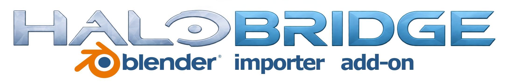

# HaloBridge v0.8.9 — Beta

## Download and update

Download **HaloBridge-0.8.9.zip** to install the Blender addon. **HaloBridge-0.8.9-source.zip** is for developers. Save your scene, finish/cancel active jobs, remove the old addon through Blender Preferences, restart Blender, install the new ZIP, and enable HaloBridge. Keep your cache and project records.

## Highlights since the previous GitHub release (v0.8.5)

Original Halo 3 vehicle placements, foliage collision corrections, live preparation activity logs, clearer build warnings, and a reorganized sidebar are included in this release. Download **HaloBridge-0.8.9.zip** for Blender; the source ZIP is for development.

**Original vehicles:** select the imported model in the 3D View, click **Find matching original vehicles**, then **Use original Halo 3 vehicle** and choose the intended tag. Keep terrain/floor geometry in the scene. Vehicle preview meshes are omitted from static geometry; no mesh splitting is performed.

**Collision:** ordinary static meshes still use collision generated from current collidable surfaces. Their original scenery/BSP collision tags are not automatically restored. The vehicle-tag route reuses the original vehicle and its collision. Foliage handling does not make every imported mesh valid for Halo's compiler.

## Changes in 0.8.9

- Boxed warning/error notices with larger alert headings. Errors, Resolve Conflict and Cancel actions use Blender's red alert styling.
- Prepare, Open in Sapien and Continue with warnings use larger highlighted buttons. Continue has a checkmark; native Blender operator buttons do not expose individual green fills. Colors follow the user's Blender theme.
- The static export warning explicitly explains that collision is rebuilt from collidable Blender surfaces and original collision tags are not reused on this route. Original vehicle placements retain their game-tag route.
- Background Blender checks passed for message panels, wrapping, registration, activity/sidebar layout, warning confirmation, cancellation and original error preservation. No global theme changes were made.

## Changes in 0.8.8

- Halo foliage shader materials no longer become solid collision automatically. Existing render-only material flags are respected. The verified Citadel `cit_tree_leafc` generic leaf shader is also treated as render-only, while bark stays collidable.
- A material-level Collision selector offers Automatic, Collidable, and Render only. Select an object and its material slot under Materials and Shaders. Shared material settings affect every object using that material. Transparent shaders are not universally treated as foliage.
- Player-start placement and main-structure selection ignore render-only faces.
- Successful preparations now report remaining overlap, duplicate-triangle and related geometry warnings using Blender object names, instead of presenting an unqualified success. Full warnings remain in the preparation report and jobs folder.
- Real Halo 3 compiler comparison using the stock Citadel pine: 524 overlap warnings with prior settings; zero with final automatic handling. This is not a guarantee that every vegetation asset or edited mesh is valid. 28 automated checks and Blender geometry/sidebar checks passed.

## Changes in 0.8.7

- Original Halo 3 vehicles can now be placed as existing vehicle tags instead of compiling their preview meshes into static level geometry. Select the imported model in the 3D View, use **Find matching original vehicles**, then **Use original Halo 3 vehicle** and choose the intended tag.
- Matching follows the actual vehicle-to-model-to-render-model references in H3EK. Tags, physics, collision and behavior are reused; no mesh splitting is performed.
- Position, rotation and positive uniform scale are transferred. Origin-only changes can be recovered from the cached preview. Reshaped meshes and modifiers are rejected for this route; Blender material changes do not change the original vehicle.
- Repeat preparation updates or removes Blender-owned vehicles, retains existing scenario vehicles and detects conflicting edits.
- Verified with actual Scorpion preview data, a real Halo 3 structure compile and scenario tag inspection. Add/move/delete/conflict tests passed on a temporary stock-scenario copy. Driving and multiplayer behavior still require an in-game playtest.

## Changes in 0.8.6

- Preparation shows five overall stages, elapsed time, remaining stages and actual compiler substep output. Compiler percentages are not overall completion estimates; time remaining is unknown when Halo does not report it.
- CPU activity and memory readings help distinguish a quiet compiler from an idle one. CPU activity alone does not guarantee that a build will complete.
- Live activity and raw compiler logs open in Blender's Text Editor and refresh during background preparation. Full timestamped logs remain in the managed jobs folder. Final failures and cancellations are retained.
- The selected main structure mesh and its triangle count are logged, with a performance advisory for dense structure geometry. This update does not simplify geometry or claim faster compilation.
- Blue import buttons, a centered Asset List heading and divider, and separate Selected Asset, Materials and Shaders, Sky, and Sapien Preparation groups.
- Validation: 26 automated checks plus Blender 4.0 activity/panel, warning handling and edited-geometry checks. No new full Sapien playtest was performed for this UI update.

## Changes retained from 0.8.5

- **Skip objects with export problems:** optional partial preparation lists each excluded object and reason before confirmation. Objects stay in Blender. Compiler failures still stop preparation; at least one valid mesh is required.
- **Material validation:** uses materials assigned to evaluated faces. Unused material slots no longer prevent export. Highlighting an Asset List material still does not assign it.
- **Preparation warnings:** Continue/Cancel remain visible above Prepare. Warnings are no longer saved as failed builds, and underlying error lists are no longer overwritten by a generic confirmation error.
- **Existing shader picker:** shaders are grouped by level/shared category and selected through a searchable popup. Use Scan existing shaders first. Manual path entry remains available.
- **Sky picker:** searchable selection, visible selected scenario path, and selection stored independently of the scanned list. Use Find map skies first.
- **Level Imported:** normalized map-name matching and retained dropdown entries improve selection stability. The exact reported disappearance was not reproduced locally.
- **Static model:** replaces the confusing Source check label.
- **Export target:** Halo 3 supported; Reach Sapien is explicitly unavailable. Reach assets can still be converted to static Halo 3 geometry.

## Requirements and guides

Windows x64, Blender 4.0, .NET 10 Desktop Runtime, and your own MCC map files. The complete Halo 3 workflow requires H3EK with extracted tags, .NET Framework 4.8+, and Halo Asset Blender Development Toolset 2.364.0.

[Installation](https://github.com/BarnacleBoii/HaloBridge-Blender-4.0-Asset-Map-Importer-Addon-BETA/blob/main/docs/INSTALLATION.md) · [Feature guide](https://github.com/BarnacleBoii/HaloBridge-Blender-4.0-Asset-Map-Importer-Addon-BETA/blob/main/docs/FEATURES.md)

## Verification and limits

28 unit tests and Blender checks for partial export, source-scene preservation, shader assignment, filters, warning handling, Reach conversion and edited geometry passed. A real Halo 3 asset exported to ASS with its shader references intact while an invalid plane was omitted. The installed H3EK shader catalogue and a real sky scenario were checked. This is not a full playtest of testleveldudebro or all maps, nor visual validation of every popup on every display.

Sapien preparation remains experimental static geometry with generated collision. Marked original Halo 3 vehicles reuse their existing game tags. General gameplay, AI, scripts and multiplayer rules are not reconstructed. Some sky/object placement differences and map extraction omissions remain unresolved. Project Reclaimer multiplayer packaging is not verified. No Halo game content is bundled.

### Known conflict-check limitation

Saving in Sapien can alter vehicle record data even when its visible transform is unchanged. The current ownership check compares the full managed vehicle record and can therefore request conflict resolution conservatively. Review your edits before using **Resolve Conflict: Use Blender**; this authorizes Blender to update its managed placements. Independently added Sapien objects remain preserved. This release does not claim to fix that conservative conflict check.
