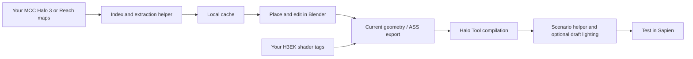

# How HaloBridge v0.9.1 works

[Home](../README.md) · [Feature guide](FEATURES.md) · [Contributing](../CONTRIBUTING.md)

## From a map file to Blender

1. The Blender add-on asks the bundled extraction helper to index your local MCC Halo 3 or Halo: Reach `.map` files. The catalogue stores asset identities, source map information, material references and cache locations.
2. First-use extraction reads geometry and bitmap data through the bundled Reclaimer libraries. Results are cached on your computer. Blender creates preview materials and shared meshes from this data.
3. Single-asset placement uses the 3D cursor or a matching preview's transform. Whole-map import instead reads source placement matrices and reconstructs the available static layout in collections.

For individual Halo 3 BSP instances, placement additionally calls the H3EK tag helper to obtain collision metadata. This is why that route still needs extracted kit tags even though the visible meshes/textures come from MCC. Whole-map visual extraction takes a different route.

The runtime path uses extracted mesh/texture cache data for Blender previews, rather than requiring you to export each asset manually in Reclaimer. Legacy AMF/JMS library support remains in the code, but it is not needed for the normal public workflow.

## From Blender to Sapien

1. Preparation reads current evaluated mesh geometry, including modifiers and edits. It copies the geometry into a temporary export scene, converts working scale to Halo units, and keeps the source scene intact.
2. Preview-only objects are excluded. Imported sky meshes and sky-only faces are handled separately; a generated sky boundary encloses the solid geometry.
3. Halo 3 material references resolve to installed shader tags. Reach materials generate simplified Halo 3 bitmap/shader tags from supported preview textures. Unique aliases are staged under the output level, retaining their bitmap references.
4. The required Halo Asset Blender Development Toolset exports ASS geometry. H3EK Tool compiles level tags from the render geometry and selected collision geometry. Automatic collision tries matched source geometry before its static fallback.
5. A C# helper using the installed ManagedBlam library updates scenario settings, applies the selected sky, and adds an initial test start if no starts exist. Optional draft lighting uses Tool's draft preset.
6. Successful preparation can launch Sapien. On normal failure or cancellation, the output transaction restores the prior generated files.

This pipeline does not extract a full editable mission with all original gameplay behavior. Ordinary meshes export as static geometry. Explicitly verified Halo 3 vehicle placements instead reference original vehicle tags and are omitted from static meshes. Original collision, model animation and gameplay logic are not reconstructed from the imported render meshes.

## Storage and repeat preparation

The local catalogue and cached assets avoid repeat extraction. Project manifests track ownership and successful output state. Backups support rollback. Keep these records with your project; local paths are not automatically portable between machines.

Sapien must be closed during preparation to avoid concurrent writes. Existing player starts are retained. Independently added Sapien content is intended to remain separate, but community projects should still keep backups: full repeat-export behavior across arbitrary maps has not been broadly validated.

## Source layout

| Folder | Responsibility |
| --- | --- |
| `halo_bridge/` | Blender UI, catalogue, preview, import, geometry export and build orchestration |
| `source/Extractor/` | .NET extraction helper |
| `source/Reclaimer/` | Pinned corresponding Reclaimer source and license |
| `source/TagBridge/` | ManagedBlam scenario helper |
| `tests/` | Synthetic Python and Blender regression fixtures |
| `scripts/package.py` | Audited binary/source release archives |

Helpers exchange JSON jobs and results with the add-on. No online account or cloud extraction service is needed to use HaloBridge. Third-party dependencies and licenses are listed in [THIRD-PARTY.md](../THIRD-PARTY.md).

## Shared game framework

The import profile chooses maps/catalogue/cache; the export destination chooses kit/shaders/skies/compiler. `halo_bridge/games.py` centralizes capabilities. Adding another game requires a validated extraction/conversion adapter, not just adding a dropdown label. The shared sidebar uses the same preview, organization, diagnostics and preparation components for Halo 3 and Reach.

Editable materials have a separate export route. Preparation bakes the supported Blender material graph, imports level-local bitmaps and builds Halo 3 shader tags. See [Editable materials](EDITABLE-MATERIALS.md).

## Material and collision changes in v0.9.1

The extraction cache can carry named shader parameters and shader options. Supported Halo 3 albedo previews use these names to combine base/detail textures. Terrain preview and editable painting use a separate layered graph. Paired transparent faces can receive geometry-specific material copies with backface culling.

Original collision lookup verifies imported source geometry and reads eligible model collision from the source Editing Kit. It transforms collision into the temporary export geometry. Static instances are recompiled for the Halo 3 destination. The existing vehicle route instead uses vehicle tags, with optional level-local copies for custom paint.

Oversized temporary instances are partitioned to fit render-index limits. This preserves the original scene object and visible geometry. Compiler limits on main structure geometry and clusters still apply.

