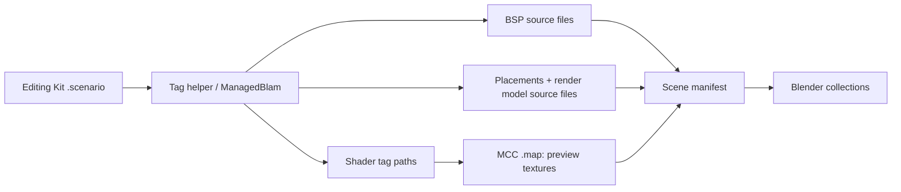
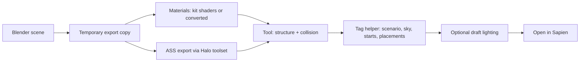

# How HaloBridge works

[Home](../README.md) · [Sidebar reference](FEATURES.md) · [Contributing](../CONTRIBUTING.md)

This page explains what happens behind each button, for curious users and contributors.

## The pieces

HaloBridge is a Blender add-on (Python) plus two helper programs it runs in the background:

| Part | Language / runtime | Job |
| --- | --- | --- |
| `halo_bridge/` | Python, inside Blender | The sidebar, the asset list, Blender scene building, geometry export and the build steps |
| **Extraction helper** (`bin/extractor`, source in `source/Extractor`) | C#, .NET 10 | Reads MCC `.map` files using the bundled [Reclaimer](https://github.com/Gravemind2401/Reclaimer) libraries: indexes assets, extracts meshes and textures, reads whole levels |
| **Tag helper** (`bin/tags`, source in `source/TagBridge`) | C#, .NET Framework 4.8 | Reads and writes Editing Kit tags through the kit's own `ManagedBlam.dll`: scenarios, collision, shaders, bitmaps, skies, placements |

The add-on and helpers talk through JSON files: the add-on writes a job file to the storage folder's `jobs` folder, runs the helper, and reads its result. Every run keeps a log next to its job file. Nothing is sent over the internet.

The helpers don't ship any Halo code or content. The tag helper loads `ManagedBlam.dll` from the Editing Kit you selected, and the extraction helper reads your own `.map` files.

## Finding folders

**Detect folders** reads Steam's library list (`libraryfolders.vdf`, found through the Windows registry), checks `SteamLibrary` folders on local fixed drives, reads Foundry's settings in `%APPDATA%\Osoyoos`, and looks for Xbox app / Game Pass installs in `XboxGames` folders. A kit counts only if it contains `tool.exe`; a maps folder counts only if it contains `.map` files. Storage defaults to the Windows Documents folder as Windows reports it, so OneDrive-redirected folders work.

## Importing a level from a .scenario

### Halo 3, ODST and Reach

1. The tag helper opens the scenario and reads its BSP list, every object palette and placement block (scenery, crates, machines, controls, vehicles, weapons, equipment), the skies, and each placed object's model, render model, collision model and variants. It copies the compressed source files (ASS for BSPs, JMS for render models) that each tag keeps in its import information. Nothing in the kit is changed.
2. `source_formats.py` checks each source file's size and checksum and parses it. BSP instances keep their names and transforms; render models keep the pieces each placement's variant selects.
3. `scenario_scene.py` names each material after the shader tag the geometry actually uses and carries its flags. The extraction helper then looks those exact shader paths up in the matching `.map` for preview textures.
4. Blender builds the collections. During preparation, unedited scenery becomes placements of its original tag (`original_scenery.py`).

For **Reach**, HREK tags have no source files, so placements come from the tags and geometry from the `.map`.

### Halo: CE and Halo 2

These kits have no ManagedBlam. `classic_scenario.py` runs the kit's own Tool (`build-cache-file`) to build a map from the scenario, moves the built map into HaloBridge's `kit_maps` folder (restoring any kit map of the same name), and then imports it like **Import entire .map**. The built map is reused until the scenario folder's tags change.

## Importing from a .map

1. **Index** — the extraction helper lists every model, scenery object, BSP instance and shader in the map and writes `catalogue.json`. Nothing heavy is extracted yet.
2. **First use** — when you preview or place an asset, the helper extracts its geometry and textures into `assets\<id>`. The cache is checked against the map files' sizes and dates, so it's reused until the maps change.
3. **Whole map** — the helper reads every BSP and object placement and writes a scene manifest; the add-on builds shared meshes and collections from it.

Placing a single Halo 3 BSP instance also asks the tag helper for its collision, which is why that one route needs H3EK.

## Preparing for Sapien

1. **Scene export.** Every visible mesh is copied into a temporary scene with modifiers applied and scaled back to Halo units. Previews, the starter template's guide objects, sky models and special surfaces are left out. Your own scene isn't touched.
2. **Materials.** Each material resolves to a shader tag in the destination kit. Materials from another game are converted: their textures are written as new bitmaps and new shaders under `levels\multi\<level>\shaders`. Editable materials are baked.
3. **Geometry and collision.** The Halo toolset's ASS exporter writes the level, and Tool compiles it. Collision is chosen per object: original collision from the source game's kit when the mesh is proven unchanged, otherwise a box or mesh surfaces. If Tool rejects an object's collision, it's retried with a box and then without collision. Very large instances are split into aligned pieces.
4. **Sky and scenario.** The tag helper sets the sky, adds a test player start if there are none, and writes original scenery and vehicle placements. A sky from another game is exported as a render model, built with Tool's `render-sky`, and wrapped in model and scenery tags.
5. **Lighting (optional).** Tool's draft lighting runs in 16 stages. Converted skies have no lighting, so the level is lit with a kit sky first and the converted sky is swapped in afterwards.
6. **Open.** Sapien can be launched with the new scenario.

Every build is a transaction: the files HaloBridge writes are recorded in `projects\`, the previous version is kept in `backups\`, and a failure or cancel restores it.

## Source layout

| Folder | Contents |
| --- | --- |
| `halo_bridge/` | The Blender add-on |
| `source/Extractor/` | Extraction helper source |
| `source/Reclaimer/` | The pinned Reclaimer source it builds against, with its license |
| `source/TagBridge/` | Tag helper source |
| `source/Build.ps1` | Builds both helpers (needs the .NET 10 SDK and an H3EK for `ManagedBlam.dll`) |
| `tests/` | Python unit tests and Blender tests using synthetic data |
| `scripts/package.py` | Builds the release ZIPs and checks them for game content and personal paths |

`halo_bridge/games.py` lists each game's capabilities. Adding a game needs a working extraction and conversion adapter, not just a new entry in the drop-down. Third-party credits are in [THIRD-PARTY.md](../THIRD-PARTY.md).
